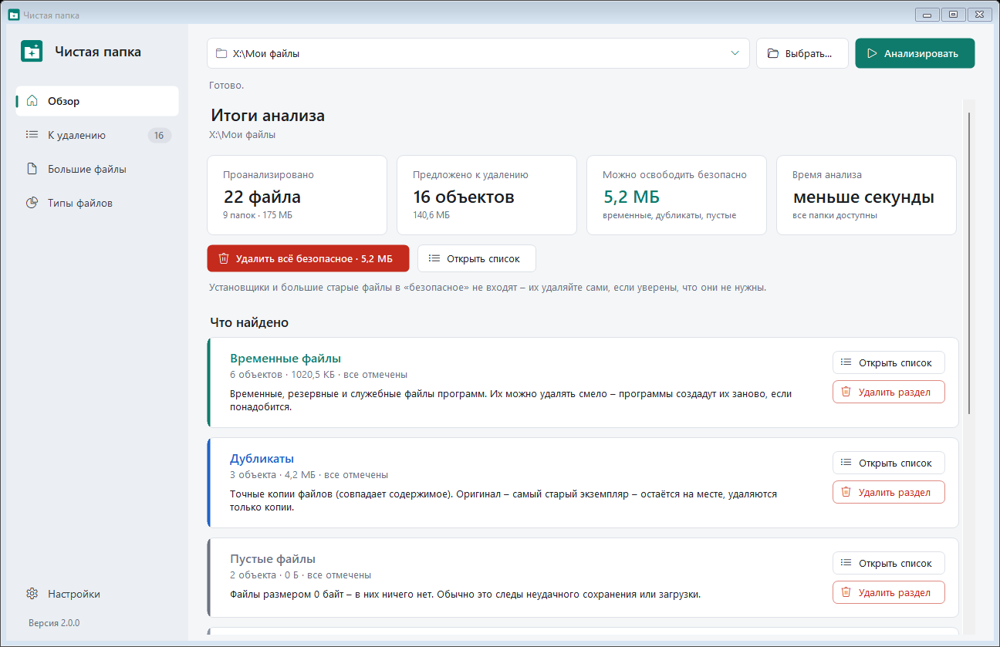
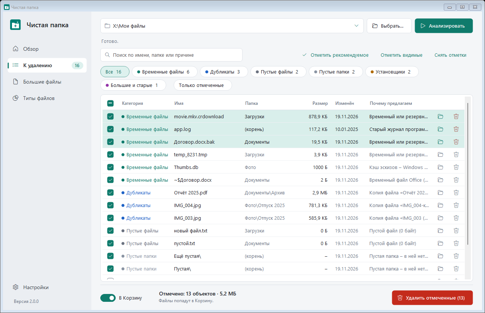
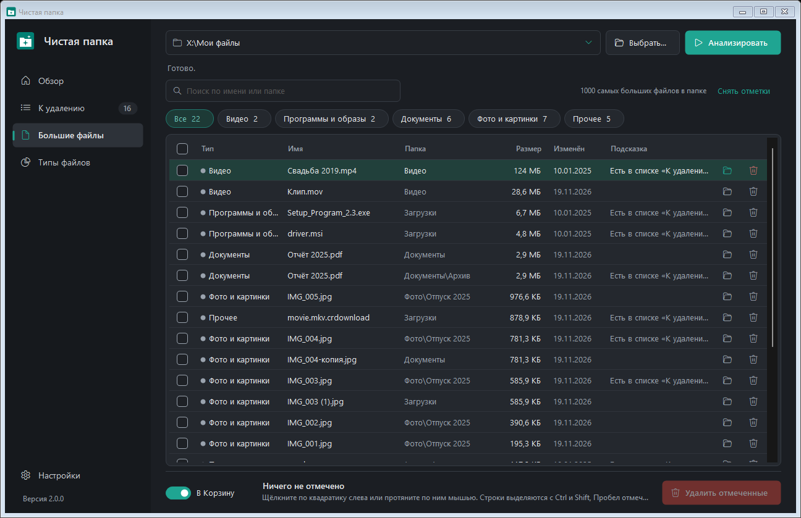

<p align="center"></p>

<h1 align="center">Чистая папка</h1>

<p align="center">Небольшая программа для Windows 10/11: анализирует папку и подсказывает, что можно удалить.<br>
<i>A small Windows app that scans a folder and suggests what can be safely deleted.</i></p>

<p align="center"><a href="https://github.com/worldruschel/clean-folder/releases/latest"><b>Скачать последнюю версию</b></a></p>

---



## Что умеет

- **Находит мусор:** временные и резервные файлы, старые журналы, копии-дубликаты (по содержимому), пустые файлы и папки, старые установщики, большие файлы, которые давно не открывали.
- **Обзор с итогами:** сколько места можно освободить, карточки по разделам с объяснением и кнопками «Открыть список» и «Удалить раздел», кнопка «Удалить всё безопасное».
- **Удобный список:** значок папки – показать файл в Проводнике, значок корзины – удалить. Отметки щелчком, Shift+щелчок – диапазон, можно протянуть мышью; строки выделяются с Ctrl и Shift, Пробел отмечает выделенные, Del удаляет. Контекстное меню: копировать путь, отметить всё в папке или разделе, больше не предлагать файл или папку.
- **Фильтры и поиск** по разделам, типам файлов, имени и папке, «только отмеченные».
- **Большие файлы и типы файлов:** топ-1000 самых крупных файлов с удалением, доля места по типам (видео, фото, документы…).
- **Безопасность:** по умолчанию всё уходит в Корзину; перед удалением файл перепроверяется (изменился после анализа – пропускается); системные файлы, `.git`, `node_modules` не трогаются; предупреждение для корня диска и системных папок.
- **Настройки:** что искать, пороги (размер и возраст), исключения (путь, имя или маска `*.psd`), светлая и тёмная тема, пункт «Навести порядок» в меню папок Проводника.
- **Автообновление:** программа сама проверяет релизы этого репозитория, скачивает установщик, сверяет SHA-256 и ставит новую версию при закрытии (или сразу по кнопке).





## Установка

Скачайте `CleanFolder-Setup-X.Y.Z.exe` со страницы [релизов](https://github.com/worldruschel/clean-folder/releases/latest) и запустите. Права администратора не нужны: программа ставится в `%LOCALAPPDATA%\Programs\CleanFolder`, создаёт ярлык «Чистая папка» на рабочем столе и в «Пуске». Нужен .NET Framework 4.8 (уже есть в Windows 10 1903+ и Windows 11).

Удаление – «Параметры → Приложения» или ярлык «Удалить» в «Пуске».

## Что считается мусором

| Раздел | Правило | Отмечено сразу |
|---|---|---|
| Временные файлы | `.tmp .temp .bak .old .dmp .chk .crdownload .part …`, `~$*` (Office), `Thumbs.db`, `.DS_Store`, `.log` старше 30 дней | да |
| Дубликаты | одинаковый размер и MD5; оригинал – самый старый экземпляр, предлагаются только копии | да |
| Пустые файлы | 0 байт (кроме `.gitkeep`, `__init__.py` и подобных) | да |
| Пустые папки | нет ни одного файла внутри; показываются только верхние | да |
| Установщики | `.msi .msix .iso .img`, `.exe` со словами setup/install в имени, старше 30 дней | нет |
| Большие и старые | от 100 МБ и не менялись больше 180 дней | нет |

Пороги и разделы меняются в настройках.

## Сборка

```
powershell -ExecutionPolicy Bypass -File tools\build.ps1
```

Нужны .NET SDK (сборка под `net48`) и [Inno Setup 6](https://jrsoftware.org/isinfo.php). Версия задаётся в `src\CleanFolder\CleanFolder.csproj` и `installer\CleanFolder.iss` (должны совпадать). Результат – `dist\CleanFolder-Setup-X.Y.Z.exe` и `.sha256` к нему.

Выпуск новой версии (установленные копии обновятся сами):

```
powershell -ExecutionPolicy Bypass -File tools\release.ps1 -Notes "Что нового"
```

Служебные режимы без окна: `CleanFolder.exe --report <папка> <отчёт.txt>` – правила анализа, `CleanFolder.exe --selftest <пустая-папка> <отчёт.txt>` – самопроверка.

## Устройство

| Файл | Что делает |
|---|---|
| `Scanner.cs` | обход папки, правила, дубликаты, пустые папки, исключения |
| `Deleter.cs` | удаление в Корзину (SHFileOperation) или насовсем с перепроверкой |
| `MainForm.cs` | главное окно: боковое меню, обзор, списки, панель удаления |
| `ItemGrid.cs` | список с отметками (виртуальный режим, быстро и на десятках тысяч строк) |
| `Ui.cs`, `Theme.cs` | свои элементы интерфейса, светлая и тёмная тема |
| `SettingsForm.cs`, `AppSettings.cs` | настройки (реестр `HKCU\Software\CleanFolder`), пункт в меню Проводника |
| `Updater.cs` | автообновление из GitHub Releases с проверкой SHA-256 |
| `installer\CleanFolder.iss` | установщик Inno Setup |

## Лицензия

[MIT](LICENSE)

## Поддержка и обратная связь

- ❤️ Поддержать автора: [Boosty](https://boosty.to/worldruschel/donate)
- ✉️ Предложения, идеи и замечания: [worldruschel@gmail.com](mailto:worldruschel@gmail.com)
